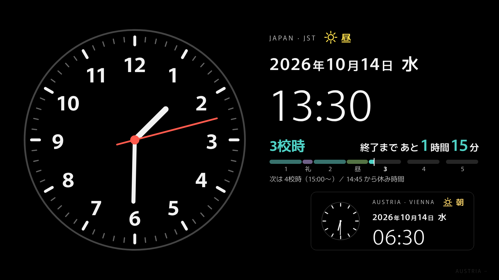
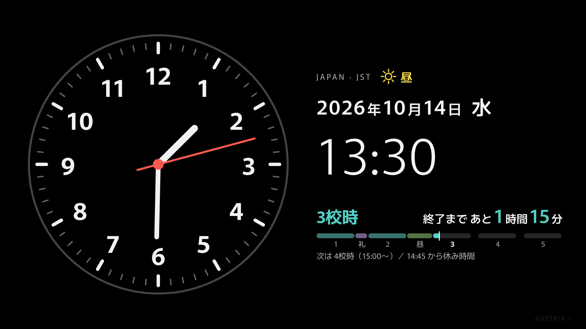
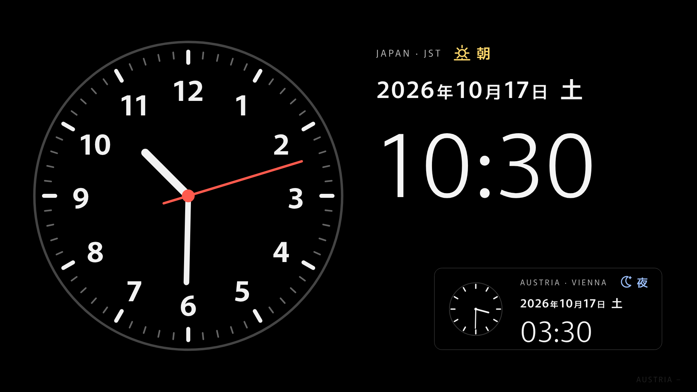

# saselab-clock

黒背景のシンプルな時計ウェブアプリ。フルHDのテレビ表示を想定しています。

公開ページ: https://sasekazu.github.io/saselab-clock/

## 表示例

平日（授業中・オーストリア表示あり）

オーストリアを非表示にした場合

土日・祝日（授業時間表示は出ません）

## 機能

- **メイン:** 日本時間（Asia/Tokyo）のアナログ時計 + 日付・曜日・時刻のデジタル表示
- **時間帯:** 早朝・朝・昼・夕・夜をアイコンと色で表示
- **授業時間:** 平日（土日・祝日を除く）に、いま何校時か・あと何分で終わる/始まるかを表示
  （1校時 8:45〜 / 礼拝 / 2校時 / 昼休み / 3〜5校時。祝日は内蔵ロジックで判定し、休校日は考慮しません）
- **サブ:** オーストリア時間（Europe/Vienna、夏時間自動対応）の小さな時計

## オーストリア表示の切り替え

次のいずれかで表示・非表示を切り替えられます。状態はブラウザに記憶されます。

- 画面右下の薄い「AUSTRIA −／＋」ボタンを押す
- キーボードの `A` キーを押す
- URL に `?austria=off`（非表示）または `?austria=on`（表示）を付ける

## 構成

ビルド不要の静的サイトです（`index.html` のみ。README 用の画像は `docs/`）。
フォントは Google Fonts の Murecho を読み込みます（オフラインでは代替フォント）。

## GitHub Pages の設定

リポジトリの **Settings → Pages → Build and deployment** で
Source を「Deploy from a branch」、Branch を `main` / `/ (root)` に設定してください。
